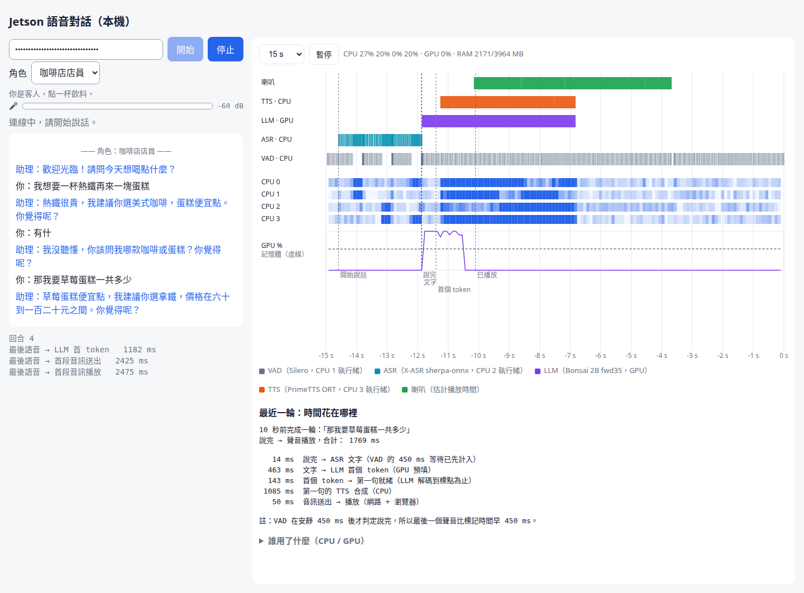

# Voice chat on the Jetson Nano

Fully local voice chat served as a WebUI from the Nano (4 cores, ~4 GB shared RAM, CUDA 10.2 sm_53).

The code is in `jetson/`; paths below are relative to it (deployed on the Nano as `~/voicechat-jetson`).

| Stage | Model | Runs on |
|---|---|---|
| VAD | Silero | CPU |
| STT | X-ASR (sherpa-onnx), gated by the VAD | CPU |
| LLM | Bonsai-2 ternary 2B, `fwd35_serve` (PULSAR engine, `engine/make_serve.py`) | GPU |
| TTS | PrimeTTS v2.1 (g2pW + VITS, onnxruntime) | CPU |
| Turn detection | Smart Turn v3.2 (off by default) | CPU |

```bash
./run.sh        # from ~/voicechat-jetson; serves https://<host>:8443, token in server/lan_token
```

The endpoint is token-gated. Never bind it publicly or expose it with Funnel; use Tailscale.
The first-chunk cut needs `jieba` (`pip install jieba` in the venv).

## WebUI and demo

The page (zh-TW) has the role selector, the live transcript with the latency of the last turn, and the
trace panel on the right (VAD/ASR/LLM/TTS/speaker timeline, per-core CPU, GPU, and where the time of
the last turn went).



The screenshot is a real session in headless Chrome with a synthetic voice fed as the microphone. That
voice makes X-ASR cut some utterances short (`有什`); human speech does not, and the transcript there
is the ASR's, shown as is.

## Role play

The page has a role selector (`app/roles.py`: voice assistant, café clerk, interviewer, Tainan guide,
telecom support). Each role is a system prompt, one of the 3 TTS voices and an opening line spoken
through the TTS without the LLM; the prompt tells the model it was already said. Picking a role
stops the audio and restarts the conversation (the first answer prefills in full, as the system
prompt changed). A reply guard in `run_turn` cuts a reply at a blank line or a repeated character or
phrase and cancels the generation: the 2B model otherwise loops (`點點點…`) or repeats its last question.
`app/roles_check.py` plays scripted dialogues per role (GPU alone), `app/role_test.py` checks the
protocol on the running server.

## CPU allocation

There is no core pinning or priority tuning: each component gets a fixed thread count and Linux
schedules the rest across the 4 cores.

| Component | Threads | Setting |
|---|---|---|
| VAD | 1 | `intra_op_num_threads` in `app/vad.py` |
| ASR | 2 | `VC_ASR_THREADS` |
| TTS (g2pW and VITS sessions) | 3 | `TTS_THREADS` |
| Smart Turn | 2 | `VC_SMART_TURN_THREADS` |
| LLM engine | 1 driver thread, ~0.25 core | GPU-bound |

The stages mostly run one after the other (ASR, then LLM, then TTS). The only real overlap is TTS
while the LLM decodes, and the settings come from `app/sched_check.py` (TTS synthesis time per
sentence, with the LLM decoding in the background):

| TTS threads | Alone | With LLM decoding |
|---|---|---|
| 4 | 1.83 s | 2.36 s (+29%) |
| 3 (chosen) | 1.84 s | 2.02 s (+10%) |
| 2 | 2.53 s | 2.66 s (+5%) |

A 4th thread gives no speed-up alone and competes with the engine's driver thread and the network
loop. Pinning TTS to cores 1-3 and the engine to core 0 gains only 0.02 s more, so it is not used.
ASR at 2 threads is already optimal (flush ~270 ms; 3 or 4 threads give no gain).
Barge-in (user speaking while the assistant speaks, ASR and TTS together) has not been measured.

## Diagnostics

- `/trace` (also embedded in the chat page): per-stage spans, per-core CPU, GPU load and RAM.
- `server/rec/`: the mic audio of the last 4 sessions (`.wav`) with an event log (`.log`:
  `speech_start`/`speech_end` offsets, last partial vs final text). It stays on the device and is not tracked.
- Checks (stop the server first for the ones that need the GPU): `app/bench.py`, `app/text_check.py`,
  `app/llm_cont_check.py`, `app/tts_cut_check.py`, `app/tts_stream_check.py`, `app/sched_check.py`,
  `server/bargein_test.py`.
